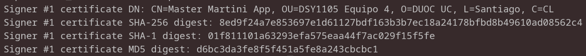
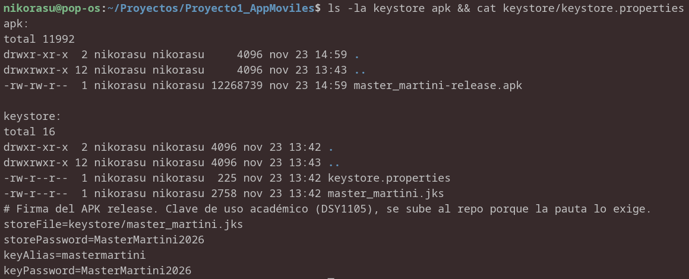

# Master Martini · App de contenidos técnicos

Aplicación Android nativa desarrollada para las **Evaluaciones Parciales 2 y 4** de **DSY1105 Desarrollo de Aplicaciones Móviles** (DUOC UC), basada en el caso **Master Martini Chile SPA**.

Master Martini es una comercializadora de insumos para alimentos que busca fortalecer la relación con clientes y prospectos mediante contenidos de valor. Esta app entrega **recetas, videos técnicos y cursos** a emprendedores y profesionales gastronómicos (panaderías, pastelerías, chocolaterías, casinos y restaurantes). Registra el perfil del negocio y sus intereses para **recomendar contenidos** y mantener información segmentada de los usuarios.

La interfaz está pensada para **usuarios mayores de 50 años con distintos niveles de manejo digital**: letra grande, alto contraste, opciones fáciles de tocar y mensajes de error claros con ejemplos.

La versión EP4 agrega un **microservicio propio en Spring Boot** (CRUD de eventos y talleres), el consumo de una **API externa** (TheMealDB), **tests unitarios** con MockK y un **APK firmado**.

> MVP académico: todos los datos (usuarios, contenidos, chefs) son **ficticios**. No se usan credenciales ni datos personales reales.

---

## Integrantes

| Integrante |
|---|
| Nicolás Gabriel Aldea Fernández |
| Vicente Agustín González Pinto |

**Equipo:** 4 · **Sección:** 003V

---

## Funcionalidades implementadas

**Bienvenida y sesión**
- Pantalla de bienvenida animada que reconoce si ya existe un perfil ("Hola de nuevo, …").

**Formularios con validación**
- **Registro**: nombre, correo, teléfono, dirección, RUT de empresa, tipo y tamaño de negocio.
- **Encuesta de intereses**: especialidades, formato preferido, nivel de experiencia y aviso de novedades. Se puede editar después desde el perfil.
- Cada campo tiene ícono, check de campo correcto y mensaje de error animado.
- El RUT se valida con **dígito verificador (módulo 11)**.

**Catálogo**
- Saludo personalizado y filtros por especialidad.
- Sección **"Recomendado para ti"** según la encuesta.
- Detalle de cada contenido con duración, nivel, chef y pasos numerados.
- Los videos se muestran como miniatura y se abren con **"Ver video"**.

**Eventos y talleres (CRUD con el microservicio) — EP4**
- Lista de eventos de Master Martini traída del microservicio Spring Boot con **Retrofit**.
- **Crear**, **editar** y **eliminar** eventos (con diálogo de confirmación).
- Formulario validado en la app (título, descripción, fecha AAAA-MM-DD no pasada, lugar, especialidad y cupos 1–500) y **también en el servidor** (Bean Validation → error 400).
- Si el servidor no está encendido, la app muestra un mensaje claro y el botón **Reintentar**.

**Ideas de postres (API externa) — EP4**
- Pestaña **Ideas** con postres de la API pública **TheMealDB**, con imagen (Coil) y nombre.

**Favoritos**
- Corazón animado para guardar contenidos y pestaña propia de favoritos.

**Perfil**
- Datos del negocio y de contacto, intereses y cantidad de favoritos.
- **Foto de perfil** desde la **cámara** o la **galería**.

**Navegación y animaciones**
- Menú inferior animado (Contenidos · Eventos · Ideas · Favoritos · Perfil).
- Transiciones entre pantallas y **animación de carga** al entrar a cada sección y al guardar.

**Persistencia**
- Local en el teléfono con **Room (SQLite)**: perfil, intereses, favoritos y foto.
- Remota en el microservicio (**H2** en archivo): eventos y talleres.

---

## Endpoints

**Microservicio propio** (`backend/`, Spring Boot 3.3 · Java 17 · JPA · H2) — base `http://localhost:8080`

| Método | Ruta | Descripción | Respuesta |
|---|---|---|---|
| GET | `/api/eventos` | Lista los eventos ordenados por fecha | 200 |
| GET | `/api/eventos/{id}` | Obtiene un evento | 200 / 404 |
| POST | `/api/eventos` | Crea un evento | 201 / 400 |
| PUT | `/api/eventos/{id}` | Actualiza un evento | 200 / 400 / 404 |
| DELETE | `/api/eventos/{id}` | Elimina un evento | 204 / 404 |

Ejemplo de cuerpo:
```json
{ "titulo": "Taller de templado de chocolate", "descripcion": "Práctica guiada de templado y moldeado.",
  "fecha": "2026-12-15", "lugar": "Sala Master Martini, Santiago", "categoria": "CHOCOLATERIA", "cupos": 20 }
```
`categoria` acepta: CHOCOLATERIA, PASTELERIA_VITRINA, HELADERIA, BOLLERIA, MASAS_HOJA, GALLETAS, EMPANADAS, HORNEO.

**API externa** — [TheMealDB](https://www.themealdb.com/api.php) (gratuita, sin clave)

| Método | URL | Uso |
|---|---|---|
| GET | `https://www.themealdb.com/api/json/v1/1/filter.php?c=Dessert` | Ideas de postres (nombre e imagen) |

---

## Recursos nativos y permisos

| Recurso | Uso | Permiso |
|---|---|---|
| Internet | Microservicio de eventos y API externa | `INTERNET` (no requiere aceptación) |
| Cámara | Tomar la foto de perfil | `CAMERA`, solicitado al momento de usarla |
| Galería de fotos | Elegir la foto de perfil | `READ_MEDIA_IMAGES` / `READ_MEDIA_VISUAL_USER_SELECTED` (Android 13+) o `READ_EXTERNAL_STORAGE` (Android 12 o inferior), solicitado al momento de usarla |

Si el usuario rechaza un permiso, la app muestra un mensaje y sigue funcionando. La foto se guarda en el almacenamiento interno y privado de la app.

---

## Tecnologías

| Tecnología | Uso |
|---|---|
| Kotlin 2.0 | Lenguaje |
| Jetpack Compose + Material 3 | Interfaz |
| MVVM (ViewModel + StateFlow) | Arquitectura y manejo de estado |
| Room 2.6 + KSP | Persistencia local (SQLite) |
| Navigation Compose | Navegación entre pantallas |
| Coroutines + Flow | Operaciones asíncronas y datos reactivos |
| Retrofit 2.11 + Gson | Consumo del microservicio y de la API externa |
| Coil 2.7 | Carga de imágenes desde internet |
| Spring Boot 3.3 (Java 17, JPA, Validation, H2) | Microservicio de eventos |
| JUnit 4 + MockK + kotlinx-coroutines-test | Tests unitarios de ViewModels, repositorios y validaciones |
| JUnit 5 + MockMvc | Tests del microservicio |

- compileSdk 36 · minSdk 24 (**Android 7.0 o superior**)
- Android Gradle Plugin 8.12.3 · Gradle 8.13 · JDK 17 o 21

---

## Arquitectura (MVVM)

```
Pantalla (Compose) → ViewModel (StateFlow) → Repository → DAO → Room (SQLite)
                                           └→ Retrofit → Microservicio Spring Boot (H2) / TheMealDB
```

- Las **pantallas** solo muestran el estado y envían las acciones del usuario.
- Los **ViewModels** contienen la lógica y validan usando `Validadores`.
- Los **Repositories** son el único punto de acceso a los datos (locales o remotos) y devuelven `Result` para manejar los errores de red.

## Estructura del proyecto

```
app/src/main/java/com/example/master_martini/
├── data/
│   ├── local/
│   │   ├── model/       # Listas fijas: especialidades, tipos de contenido y de negocio
│   │   ├── entity/      # Tablas de Room
│   │   ├── dao/         # Consultas a la base de datos
│   │   ├── database/    # Base de datos Room
│   │   ├── seed/        # Contenidos ficticios iniciales
│   │   └── AlmacenFotos.kt
│   ├── remote/          # Retrofit: DTO, APIs y cliente HTTP
│   └── repository/      # Acceso único a los datos (local y remoto)
├── validation/          # Reglas de validación (con tests)
├── viewmodel/           # Estado y lógica de cada pantalla
├── ui/
│   ├── components/      # Componentes reutilizables y animaciones
│   ├── screens/         # Pantallas
│   └── theme/           # Colores y tipografía accesibles
├── navigation/          # Rutas y menú inferior
├── MasterMartiniApp.kt
└── MainActivity.kt

backend/                 # Microservicio Spring Boot (controller, service, repository, model)
keystore/                # master_martini.jks y keystore.properties (firma del APK)
apk/                     # APK release firmado
```

---

## Cómo ejecutar el proyecto

**Requisitos**
- Android Studio reciente (2025 o superior).
- JDK 17 o 21 (Android Studio incluye uno: *jbr-21*).
- Emulador o celular con **Android 7.0 o superior**.

**1. Levantar el microservicio** (necesita Java 17+ y Maven)
```bash
sudo apt install maven          # solo la primera vez (Linux)
cd backend
mvn spring-boot:run             # queda escuchando en http://localhost:8080
```
La primera vez carga 3 eventos de ejemplo. Consola de la base: `http://localhost:8080/h2-console` (JDBC URL `jdbc:h2:file:./data/mastermartini`, usuario `sa`).

**2. Conectar el celular o emulador al microservicio**
```bash
adb reverse tcp:8080 tcp:8080   # el 127.0.0.1:8080 del teléfono apunta al computador
```
(Se repite cada vez que se desconecta el cable o se reinicia el emulador.)

**3. Ejecutar la app**
1. Clonar el repositorio:
   ```bash
   git clone https://github.com/Vvcentek/Proyecto1_AppMoviles.git
   ```
2. Abrir la carpeta en Android Studio y esperar el **Gradle Sync**.
3. Si se pide, configurar *Settings → Build, Execution, Deployment → Build Tools → Gradle → Gradle JDK* en **jbr-21** (o JDK 17).
4. Elegir la configuración **app** y un dispositivo (emulador o celular con depuración USB).
5. Presionar **Run ▶**.

Desde la terminal:
```bash
./gradlew assembleDebug        # Compila la app
./gradlew testDebugUnitTest    # Ejecuta los tests unitarios
./gradlew createDebugUnitTestCoverageReport   # Reporte de cobertura
./gradlew assembleRelease      # Genera el APK firmado
```
Tests del microservicio: `cd backend && mvn test`.

---

## Tests unitarios

| Archivo | Qué prueba |
|---|---|
| `ValidadoresTest`, `ValidadoresEventoTest` | Reglas de validación (RUT, correo, teléfono, fechas, cupos, etc.) |
| `EventosViewModelTest` | Listar, error sin conexión, eliminar; ideas de la API externa |
| `EventoFormViewModelTest` | Crear, editar, errores por campo, error del servidor |
| `RegistroViewModelTest` | Registro válido, campos vacíos, correo repetido |
| `EventosRepositoryTest` | POST vs PUT, DELETE, fallos de red, API externa |
| `ViewModelsLocalesTest` | Sesión, Catálogo (recomendados y filtros), Detalle, Favoritos, Encuesta y Perfil |
| `MasterMartiniRepositoryTest` | Acceso a Room: usuario, intereses, contenidos, favoritos y datos semilla |
| `backend/.../EventoControllerTest` | CRUD completo y validación 400/404 con MockMvc |

**66 tests, 0 fallas.** Cobertura de la lógica (JaCoCo): **ViewModels 88%**, **repositorios 92%**, **validaciones 94%**. Las pantallas Compose no entran en los tests unitarios.

El reporte de cobertura queda en `app/build/reports/coverage/test/debug/index.html`.

---

## APK firmado

- Llave: `keystore/master_martini.jks` (alias `mastermartini`), configurada en `app/build.gradle.kts` leyendo `keystore/keystore.properties`.
- APK: `apk/master_martini-release.apk` (generado con `./gradlew assembleRelease`).
- La llave y sus claves se suben al repositorio **solo porque la pauta lo exige**; es una llave académica, en un proyecto real nunca se publicaría.

<!-- Capturas: agregar imágenes del APK firmado y del .jks en docs/ -->



---

## Notas

- Contenidos, chefs y datos de usuarios: ficticios, creados para el prototipo académico.
- Paleta de colores provisoria, mientras se reciben los colores corporativos de Master Martini.